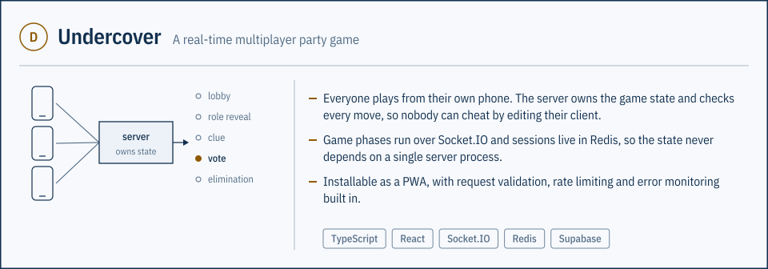
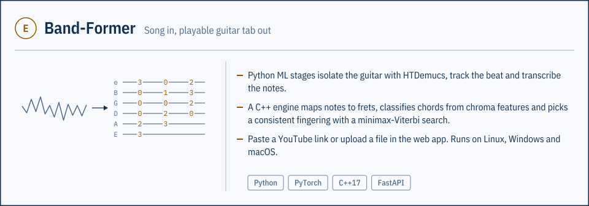
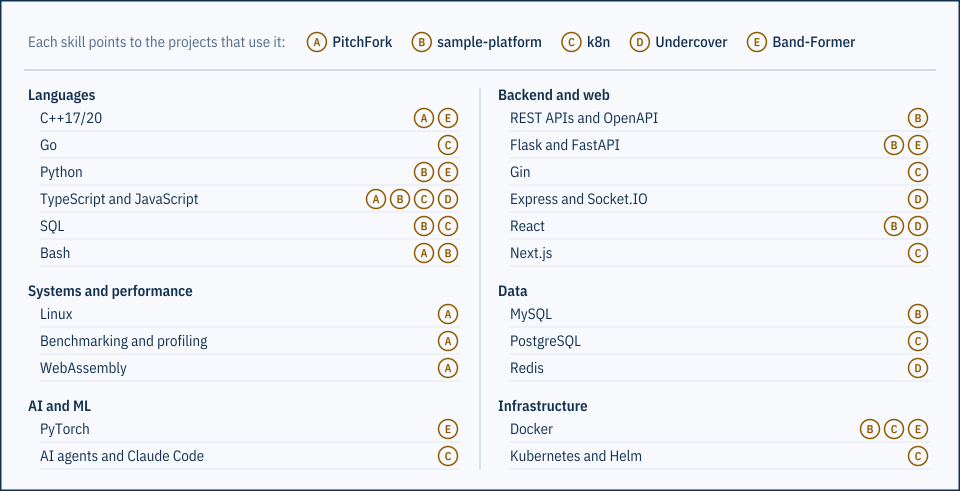

<picture>
  <source media="(prefers-color-scheme: dark)" srcset="./assets/hero-dark.svg">
  
</picture>

I'm Pulkit, a final-year CS student at UPES Dehradun. I like building the layer between raw data and the people who use it, and I try to put a measurement next to every claim. I'm looking for software engineering roles starting January 2027.

## Things I've built

<a href="https://github.com/pulk17/NASDAQ-ITCH-OrderBook">
<picture>
  <source media="(prefers-color-scheme: dark)" srcset="./assets/detail-a-dark.svg">
  
</picture>
</a>

[Code](https://github.com/pulk17/NASDAQ-ITCH-OrderBook)&nbsp;&nbsp;|&nbsp;&nbsp;[Live backtest report](https://pitchfork.pages.dev/)

<a href="https://github.com/CCExtractor/sample-platform">
<picture>
  <source media="(prefers-color-scheme: dark)" srcset="./assets/detail-b-dark.svg">
  
</picture>
</a>

[Code](https://github.com/CCExtractor/sample-platform)&nbsp;&nbsp;|&nbsp;&nbsp;[My merged commits](https://github.com/CCExtractor/sample-platform/commits/master?author=pulk17)

<a href="https://github.com/pulk17/k8n">
<picture>
  <source media="(prefers-color-scheme: dark)" srcset="./assets/detail-c-dark.svg">
  
</picture>
</a>

[Code](https://github.com/pulk17/k8n)&nbsp;&nbsp;|&nbsp;&nbsp;[Live site](https://k8n.pages.dev/)

<a href="https://github.com/pulk17/undercover-game">
<picture>
  <source media="(prefers-color-scheme: dark)" srcset="./assets/detail-d-dark.svg">
  
</picture>
</a>

[Code](https://github.com/pulk17/undercover-game)&nbsp;&nbsp;|&nbsp;&nbsp;[Play it](https://undercover-game-client.vercel.app/)

<a href="https://github.com/pulk17/Band-Former">
<picture>
  <source media="(prefers-color-scheme: dark)" srcset="./assets/detail-e-dark.svg">
  
</picture>
</a>

[Code](https://github.com/pulk17/Band-Former)

## Skills

<picture>
  <source media="(prefers-color-scheme: dark)" srcset="./assets/skills-dark.svg">
  
</picture>

## How I work

- **I measure before I optimise.** PitchFork's README lists every optimisation with its measured speed-up, plus the ones that didn't help, like io_uring and profile-guided optimisation.
- **I report results I don't like.** My order-flow signal is right 55% of the time and still loses money after costs. The write-up says so up front.
- **I test the edges.** sample-platform's API ships with 330+ tests for things like revoked tokens and two uploads with the same name.
- **I keep a human in the loop for AI.** k8n's agents can only propose changes, and every write is a dry run unless you say otherwise.

## Get in touch

[Email](mailto:chauhanpulkit1708@gmail.com)&nbsp;&nbsp;|&nbsp;&nbsp;[LinkedIn](https://www.linkedin.com/in/pulk1t/)&nbsp;&nbsp;|&nbsp;&nbsp;[Codeforces](https://codeforces.com/profile/pulk1t)&nbsp;&nbsp;|&nbsp;&nbsp;[LeetCode](https://leetcode.com/u/pulk1tt/)&nbsp;&nbsp;|&nbsp;&nbsp;[Website](https://pulk1t.vercel.app/)
