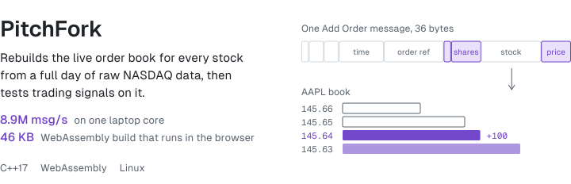
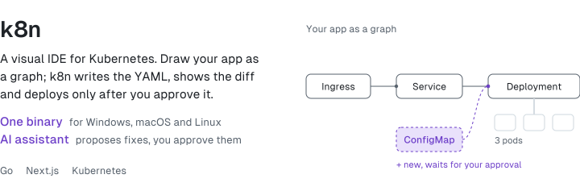
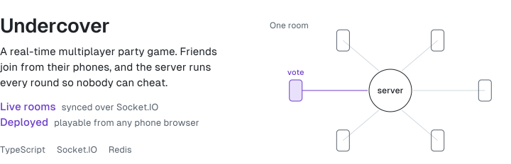

<picture>
  <source media="(prefers-color-scheme: dark)" srcset="./assets/hero-dark.svg">
  
</picture>

## Open source

<!-- contrib:start -->
Merged into ClickHouse/boost, OpenCV and CCExtractor. In review at ClickHouse, Microsoft STL and Boost.Geometry.

| Project | Contributions |
| :-- | :-- |
| **[ClickHouse](https://github.com/ClickHouse/ClickHouse)** 50.6k stars | ✓ boost: [Fix the quadrant of sin_cos_degrees for negative angles](https://github.com/ClickHouse/boost/pull/53) ○ [Add polygonMinimumRotatedRectangleCartesian, exteriorRing, interiorRingN and pointN](https://github.com/ClickHouse/ClickHouse/pull/127944) ○ boost: [Use Newton's method in karney_inverse without the reduced length](https://github.com/ClickHouse/boost/pull/54) ○ [Add lengthCartesian, lengthSpherical and lengthSpheroid functions](https://github.com/ClickHouse/ClickHouse/pull/127764) [+2 more](https://github.com/ClickHouse/ClickHouse/pulls?q=is%3Apr+author%3Apulk17) |
| **[OpenCV](https://github.com/opencv/opencv)** 91.3k stars | ✓ [Fix getRectSubPix for windows that cross the image border](https://github.com/opencv/opencv/pull/30363) |
| **[Microsoft STL](https://github.com/microsoft/STL)** 11.2k stars | ○ [Add tests for LWG-4267 Uses-allocator construction is meaningless for tuple of references](https://github.com/microsoft/STL/pull/6494) |
| **[CCExtractor](https://github.com/CCExtractor/sample-platform)** 30 stars | Google Summer of Code 2026: built sample-platform's REST API and the web console on top of it 21 merged, 1 in review&ensp;[sample-platform](https://github.com/CCExtractor/sample-platform/pulls?q=is%3Apr+author%3Apulk17) |
| **[Boost.Geometry](https://github.com/boostorg/geometry)** 517 stars | ○ [Fix the quadrant of sin_cos_degrees for angles below −45°](https://github.com/boostorg/geometry/pull/1499) |

✓ merged&emsp;○ in review&emsp;Kept up to date from GitHub by a scheduled workflow. Latest activity 27 Oct 2026.
<!-- contrib:end -->

## Projects

<a href="https://github.com/pulk17/NASDAQ-ITCH-OrderBook">
<picture>
  <source media="(prefers-color-scheme: dark)" srcset="./assets/pitchfork-dark.svg">
  
</picture>
</a>

[Source](https://github.com/pulk17/NASDAQ-ITCH-OrderBook)&emsp;[Live demo](https://pitchfork.pages.dev/)

<a href="https://github.com/pulk17/k8n">
<picture>
  <source media="(prefers-color-scheme: dark)" srcset="./assets/k8n-dark.svg">
  
</picture>
</a>

[Source](https://github.com/pulk17/k8n)&emsp;[Try the editor](https://k8n.pages.dev/)

<a href="https://github.com/pulk17/undercover-game">
<picture>
  <source media="(prefers-color-scheme: dark)" srcset="./assets/undercover-dark.svg">
  
</picture>
</a>

[Source](https://github.com/pulk17/undercover-game)&emsp;[Play it](https://undercover-game-client.vercel.app/)

**Also:** [Band-Former](https://github.com/pulk17/Band-Former) turns a song into guitar tab you can actually play. PyTorch models pick out the notes, then a C++ search chooses fingerings a real hand can reach.

## Contact

[Email](mailto:chauhanpulkit1708@gmail.com)&emsp;[LinkedIn](https://www.linkedin.com/in/pulk1t/)&emsp;[Codeforces](https://codeforces.com/profile/pulk1t)&emsp;[LeetCode](https://leetcode.com/u/pulk1tt/)&emsp;[Website](https://pulk1t.vercel.app/)
