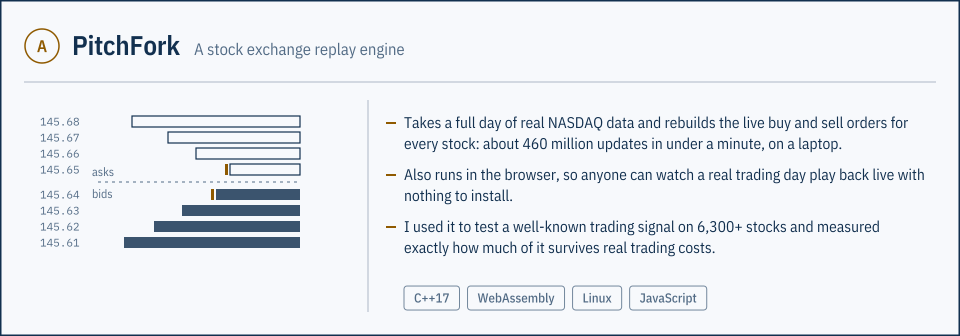
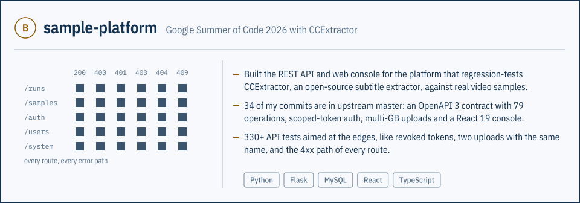
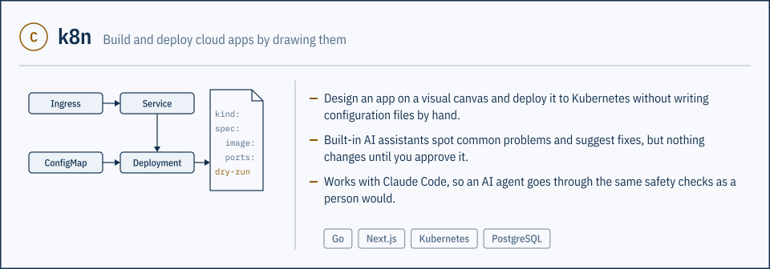

<picture>
  <source media="(prefers-color-scheme: dark)" srcset="./assets/hero-dark.svg">
  
</picture>

I'm Pulkit, a final-year Computer Science student at UPES Dehradun, graduating in May 2027. I build software that is fast, carefully tested, and backed by real numbers. I'm looking for software engineering roles starting January 2027.

## Things I've built

<a href="https://github.com/pulk17/NASDAQ-ITCH-OrderBook">
<picture>
  <source media="(prefers-color-scheme: dark)" srcset="./assets/detail-a-dark.svg">
  
</picture>
</a>

[Code](https://github.com/pulk17/NASDAQ-ITCH-OrderBook)&nbsp;&nbsp;|&nbsp;&nbsp;[Live demo](https://pitchfork.pages.dev/)

<a href="https://github.com/CCExtractor/sample-platform">
<picture>
  <source media="(prefers-color-scheme: dark)" srcset="./assets/detail-b-dark.svg">
  
</picture>
</a>

[Code](https://github.com/CCExtractor/sample-platform)&nbsp;&nbsp;|&nbsp;&nbsp;[My merged work](https://github.com/CCExtractor/sample-platform/commits/master?author=pulk17)

<a href="https://github.com/pulk17/k8n">
<picture>
  <source media="(prefers-color-scheme: dark)" srcset="./assets/detail-c-dark.svg">
  
</picture>
</a>

[Code](https://github.com/pulk17/k8n)&nbsp;&nbsp;|&nbsp;&nbsp;[Live site](https://k8n.pages.dev/)

<a href="https://github.com/pulk17/undercover-game">
<picture>
  <source media="(prefers-color-scheme: dark)" srcset="./assets/detail-d-dark.svg">
  
</picture>
</a>

[Code](https://github.com/pulk17/undercover-game)&nbsp;&nbsp;|&nbsp;&nbsp;[Play it](https://undercover-game-client.vercel.app/)

<a href="https://github.com/pulk17/Band-Former">
<picture>
  <source media="(prefers-color-scheme: dark)" srcset="./assets/detail-e-dark.svg">
  
</picture>
</a>

[Code](https://github.com/pulk17/Band-Former)

## Skills

<picture>
  <source media="(prefers-color-scheme: dark)" srcset="./assets/skills-dark.svg">
  
</picture>

## What I bring

- **Speed I can prove.** My exchange replay engine handles about 460 million updates in under a minute.
- **Code others trust.** 34 changes reviewed and merged by CCExtractor's maintainers, backed by 330+ automated tests.
- **Strong problem solving.** Candidate Master on Codeforces, with a peak rating of 1986.
- **Careful use of AI.** In k8n, AI suggests changes and a person approves them before anything happens.

## Get in touch

[Email](mailto:chauhanpulkit1708@gmail.com)&nbsp;&nbsp;|&nbsp;&nbsp;[LinkedIn](https://www.linkedin.com/in/pulk1t/)&nbsp;&nbsp;|&nbsp;&nbsp;[Codeforces](https://codeforces.com/profile/pulk1t)&nbsp;&nbsp;|&nbsp;&nbsp;[LeetCode](https://leetcode.com/u/pulk1tt/)&nbsp;&nbsp;|&nbsp;&nbsp;[Website](https://pulk1t.vercel.app/)
